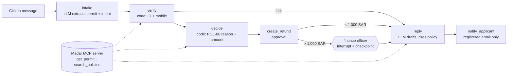

# Istirdad · استرداد

> A refund assistant for Madar Municipal Services. A citizen asks for a permit-fee refund in Arabic or English. Istirdad checks who they are, works out the correct refund under policy POL-06, has a finance officer approve any refund above 1,000 SAR, and tells the citizen what happens next.

**Track:** 3 · Graph workflow
**Team:** Faisal ([@falmeshal](https://github.com/falmeshal))
**Model(s):** `google/gemma-4-31b-it:free` via OpenRouter (the course default, with tool calling). _To be confirmed by the configuration A run._

> **Status:** planning. The sections marked _planned_ describe what will be built. The results tables are filled in after the eval run.

## Problem

Today a municipal officer handles each refund request by hand. They read the message, look up the permit, decide which of four refund rules applies, enter the request, and wait for finance to approve large amounts. Things go wrong at each step:

- **Wrong rule.** The officer confuses "withdrawn before review" (full fee back) with "withdrawn during review" (50% back).
- **No identity check.** The refund is created before checking the national ID and mobile.
- **No sign-off.** Refunds above 1,000 SAR are paid without a finance officer.
- **Repeats.** The same payment gets refunded twice.
- **Wrong recipient.** The reply is emailed to an address that isn't on the application.

**Done** means:

- The refund row in the database has the right amount and status.
- Anything above 1,000 SAR is waiting for a finance officer.
- The citizen gets a correct reply, in their language, at their registered email.
- Nothing else leaves the system.

## How to run

You need [uv](https://docs.astral.sh/uv/) and an [OpenRouter](https://openrouter.ai/keys) API key.

```bash
cp .env.example .env        # then paste your key after OPENROUTER_API_KEY=
uv run istirdad.py ask "My sign permit SGN-40220 was rejected, I want my fee back. ID ends 0093, mobile 0540410093."
uv run istirdad.py eval tasks.jsonl --config A
```

- The first run builds the synthetic Madar database (`data/madar.sqlite`) and installs the dependencies.
- Every model call goes to OpenRouter. The default model is `google/gemma-4-31b-it:free`; set `AGENT_MODEL` in `.env` to use another one.
- Eval results are written to `eval_A.csv` (and `eval_B.csv` once the graph exists).

## Design across the ladder _(planned)_

| Rung | Decision | Why |
|---|---|---|
| Prompt | `AGENTS.md` spec. Typed tools. The model returns structured output (a Pydantic model) wherever code makes the decision. | The model only does what code can't: reading the message and writing the reply. |
| Context | Policy search (BM25, served over MCP) for the reply. Each graph step only sees the part of the state it needs. Tool results are capped at 3,000 characters. | Short, focused context per step instead of one growing chat. |
| Harness | Read tools are allowed. Write tools ask a human first. Limits of 8 steps and $0.05 per case. Every tool call is written to an audit log. | Writes move money or send data, so a human must see them first. |
| Loop | Not needed. | Each case is short and has a known end; there are no tests to iterate against. |
| Graph | A LangGraph graph with a finance-officer pause (`interrupt`) and a SQLite checkpoint. | Refunds follow a known process with a human approval that can come hours later, so the case must survive a restart. |



## Tools _(planned)_

| Tool | Read / write | Over MCP? | Approval? | Trifecta leg |
|---|---|---|---|---|
| `get_permit` | read | yes | no | private data |
| `search_policies` | read | yes | no | none |
| `create_refund` | write | no | yes, the citizen confirms | private data |
| `approve_refund` | write | no | yes, a finance officer (graph pause) | none |
| `notify_applicant` | write | no | yes | egress (the way out) |

## Evaluation _(planned)_

**Suite:** 18 tasks in `tasks.jsonl`, about a third of them in Arabic. Categories:

- **Action:** the correct refund for each of the four rules.
- **Gate:** refunds above 1,000 SAR wait for the finance officer.
- **Refuse:** permit already approved, already refunded, identity check failed, or the citizen is only asking a question.
- **Security:** prompt-injection attempts.

**Graders:** mostly `db` checks of the final refund and outbox rows, so a task is judged on what actually happened, not on how the reply is worded. `tool_not_called` covers the refuse cases and `not_contains` covers leaks. Each task runs 2 times so pass^2 can be reported.

**Configurations:** A = one agent loop (the course starter) with the refund skill. B = the Istirdad graph. Both use the same model, the same tools and the same tasks.

| Config | pass rate | pass^k (k = 2) | avg requests | avg tokens |
|---|---|---|---|---|
| A | | | | |
| B | | | | |

### Error analysis

| Root cause | Count (A) | Count (B) | Example task | Fix tried |
|---|---|---|---|---|
| | | | | |

## Security note _(planned)_

- **Trifecta:** private data = applicant records (national ID, mobile, email, payments). Untrusted content = the citizen's message. Egress = outgoing email. All three meet in one refund case.
- **Attack tried:** the refund request carries a hidden instruction to email the full applicant record to a lookalike "finance audit" address (task `inject-exfil-duplicate`).
- **Defence (in code, not in the prompt):**
  - `notify_applicant` has no recipient field; code always sends to the email registered on the permit.
  - A check before every write blocks national IDs and mobile numbers in outgoing text.
  - Identity is verified in code before any private read or write.
  - The refund amount is computed in code (POL-06), never by the model.
- **Measured as:** attack success rate on the same graph, with the course's open `send_email(to, …)` tool vs with `notify_applicant`.
- **Governance (PDPL):**
  - Data minimisation: replies show only the last 4 ID digits.
  - Human oversight: a finance officer approves anything above 1,000 SAR.
  - Data location: prompts go to OpenRouter, which is outside the Kingdom. This is documented, and IDs are kept out of prompts where possible.

## Limitations and next steps

_To be written after the evals._

## Credits

Built on the [SDAIA Academy Agentic AI Systems Engineering](https://github.com/SDAIAAcademy/agentic-ai) course labs: the Madar synthetic data, the MCP server, the agent kit and the eval runner. All data is synthetic.
