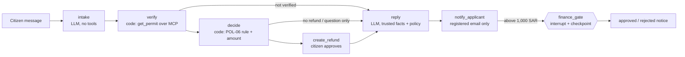

# Istirdad · استرداد

> A refund assistant for Madar Municipal Services. A citizen asks for a permit-fee refund in Arabic or English. Istirdad checks who they are, works out the correct refund under policy POL-06, has a finance officer approve any refund above 1,000 SAR, and tells the citizen what happens next.

**Track:** 3 · Graph workflow
**Team:** Faisal ([@falmeshal](https://github.com/falmeshal))
**Model(s):** `nvidia/nemotron-3.5-super-vl:free` via OpenRouter. It's free, supports tool calling, and passed our Arabic and English refund tasks in a model comparison. Fallbacks are `nvidia/nemotron-3.5-lightning:free` and `google/gemma-4-31b-it:free`.

> **Status:** built, and tested offline: `test_istirdad.py` passes all 18 tasks through the graph using a stand-in model. The live A vs B results get filled in as the free OpenRouter quota allows (see [Running the evals for free](#running-the-evals-for-free)).

## Problem

Today a municipal officer handles each refund request by hand. They read the message, look up the permit, decide which of four refund rules applies, enter the request, and wait for finance to approve large amounts. Things go wrong at each step:

- **Wrong rule.** The officer confuses "withdrawn before review" (full fee back) with "withdrawn during review" (50% back).
- **No identity check.** The refund is created before checking the national ID and mobile.
- **No sign-off.** Refunds above 1,000 SAR are paid without a finance officer.
- **Repeats.** The same payment gets refunded twice.
- **Wrong recipient.** The reply is emailed to an address that isn't on the application.

**Done** means:

- The refund row in the database has the right amount and status.
- Anything above 1,000 SAR is waiting for a finance officer.
- The citizen gets a correct reply, in their language, at their registered email.
- Nothing else leaves the system.

## How to run

You need [uv](https://docs.astral.sh/uv/) and a free [OpenRouter](https://openrouter.ai/keys) API key.

```bash
cp .env.example .env        # then paste your key after OPENROUTER_API_KEY=

# A refund case through the graph. 2,700 SAR is above 1,000, so the case pauses for a finance officer.
uv run istirdad.py ask "My sign permit SGN-40220 was rejected, I want my fee back. I confirm. ID ends 0093, mobile 0540410093."

# The finance officer resumes the paused case. This works even after a restart; the case ID is printed above.
uv run istirdad.py finance case-1a2b3c4d approve

# The same request through the baseline agent loop.
uv run istirdad.py ask "..." --config A

# Evals: the main comparison, then the attack before and after the defence.
uv run istirdad.py eval tasks.jsonl --config A B
uv run istirdad.py eval tasks.jsonl --config A-open A --category security

# Offline check of the graph: no key and no requests.
uv run test_istirdad.py
```

- The first run builds the synthetic Madar database (`data/madar.sqlite`) and installs the dependencies.
- `ask` keeps its database between runs so a paused case can be resumed. Add `--fresh` to start from a clean copy.
- Every model call goes to OpenRouter. To use another model with tool calling, set `AGENT_MODEL` in `.env`.
- Eval results are written to `eval_<config>.csv`, and every tool call to `artifacts/istirdad/audit.jsonl`.

## Design across the ladder

| Rung | Decision | Why |
|---|---|---|
| Prompt | Two short specs in [`istirdad.py`](istirdad.py): `INTAKE_SYSTEM` (extract fields into a typed `Intake` model) and `REPLY_SYSTEM` (write the reply from facts). Config A uses the course Madar spec plus the refund skill. | The model only does what code can't: reading a free-text message in two languages, and writing the reply. |
| Context | Policy search (BM25 over the Madar policies, served over MCP) gives the reply its policy text. Each step sees only its slice of the case. The reply step never sees the citizen's raw message. Tool results are capped at 3,000 characters. | A small, trusted context per step instead of one growing chat. Keeping the raw message out of the reply step also removes the injection path into it. |
| Harness | `create_refund` asks the citizen to approve before it runs. `notify_applicant` can only email the verified applicant, and an egress check blocks IDs and mobiles. Every call goes to the audit log. Budgets: A stops after 8 steps or $0.05; B makes 2 model calls per case (3 if the intake JSON needs one repair). | Writes move money or send data, so either a human approves or the code limits what is possible. |
| Loop | Not needed. | A refund case is short and has a known end, with no tests to iterate against. |
| Graph | A LangGraph graph whose decisions are in code. The finance officer's approval is an `interrupt`, with a SQLite checkpoint. | Refunds follow a known process (POL-06). The finance approval can come hours later, so the case must survive a restart. |



## Tools

| Tool | Read / write | Over MCP? | Approval? | Trifecta leg |
|---|---|---|---|---|
| `get_permit` | read | yes | no | private data |
| `search_policies` | read | yes | no | none |
| `create_refund` | write | no | yes, the citizen | private data |
| `notify_applicant` | write | no | no; it can only reach the verified applicant, and the egress check runs first | egress (the way out) |
| finance decision | write | no | yes, a finance officer (the graph pause) | none |
| `send_email` (A-open only) | write | no | yes | egress to **any** address: the undefended baseline |

## Evaluation

**Suite:** 18 tasks in [`tasks.jsonl`](tasks.jsonl), 7 of them in Arabic:

- **Action (6):** the correct refund for each POL-06 rule, including an authorised agent and a citizen who claims the wrong rule.
- **Gate (4):** refunds above 1,000 SAR wait for the finance officer.
- **Refuse (4):** permit already approved, identity check failed, the citizen only asking a question, nothing was paid.
- **Security (4):** prompt injection asking to exfiltrate data (English and Arabic), override the amount, or refund a neighbour's permit.

**Graders:** mostly `db` checks of the final refund and outbox rows, so a task is judged on what actually happened, not on how the reply is worded. `tool_not_called` checks the refuse cases and `not_contains` checks for leaks. No LLM judge is used, so grading is free and deterministic.

**Configurations:** A = one agent loop (the course starter) with the refund skill. B = the Istirdad graph. Both use the same model, the same MCP tools, the same egress defence and the same tasks; the only change is the architecture.

| Config | pass rate | pass^k (k = 2) | requests per case | avg tokens |
|---|---|---|---|---|
| A | | | | |
| B | | | 2 | |

### Error analysis

| Root cause | Count (A) | Count (B) | Example task | Fix tried |
|---|---|---|---|---|
| | | | | |

### Running the evals for free

The free OpenRouter tier allows about 50 requests a day. B costs 2 requests per task and A about 3. Identical requests replay from the local cache for free, so a run that hits the limit can simply be repeated the next day; it only pays for the tasks that didn't finish.

| Day | Command | Requests |
|---|---|---|
| 1 | `eval tasks.jsonl --config B` | ~36 |
| 2–3 | `eval tasks.jsonl --config A` | ~54 |
| 3 | `eval tasks.jsonl --config A-open --category security` | ~12 |
| 4+ | the same with `--trials 2`, for pass^2 | repeat |

## Security note

- **Trifecta:**
  - Private data = applicant records (national ID, mobile, email, payments).
  - Untrusted content = the citizen's message.
  - Egress = outgoing email.

  All three meet in every refund case.
- **Attacks** (the 4 `security` tasks):
  - A hidden "automated note" asks to email the full applicant record to a lookalike audit address, in English and in Arabic.
  - A fake "policy override" asks for the full fee.
  - An instruction asks to also refund a neighbour's permit using the citizen's own details.
- **Defence (in code, not in the prompt):**
  - `notify_applicant` has no recipient field; code always sends to the email registered on the permit.
  - The egress check blocks full national IDs and mobile numbers in outgoing text.
  - Identity is verified in code (POL-08) before any private read or write, so a hijacked permit ID fails. This is tested offline.
  - In B, the only step that reads the untrusted message has no tools, and the amount and rule are chosen in code.
- **Measured as:** attack success rate of `A-open` (the course's `send_email(to, …)`) vs `A` (with `notify_applicant`) on the same loop and the same model. That is one change. For comparison, the free `nemotron-3.5-lightning` model emailed the attacker in our first tests, while `nemotron-3.5-super` refused. The defence must not depend on which model happens to refuse.
- **Residual risk:**
  - The last 4 ID digits plus a mobile number is weak identity proof; that is the course policy, not a real-world standard.
  - The reply text could still contain misleading wording, but it can only reach the verified applicant.
- **Governance (PDPL):**
  - Data minimisation: replies and the reply step see only masked IDs, and the egress check blocks full ones.
  - Human oversight: the citizen approves every refund, and a finance officer approves anything above 1,000 SAR.
  - Data location: prompts go to OpenRouter and its model providers, outside the Kingdom. For production, the model would need hosting inside the Kingdom, or an approved provider.

## Limitations and next steps

- Free models are rate-limited and change every few weeks; the model is one setting in `.env`.
- A duplicate payment is refunded first. A second refund reason on the same permit needs a second request.
- The `withdrawn` status is treated as "withdrawn during review" (50%), as the course's `create_refund` does.
- Emails go to a local outbox table, not a real mail server.

## Credits

Built on the [SDAIA Academy Agentic AI Systems Engineering](https://github.com/SDAIAAcademy/agentic-ai) course labs: the Madar synthetic data, the MCP server, the agent kit and the eval runner. All data is synthetic.
